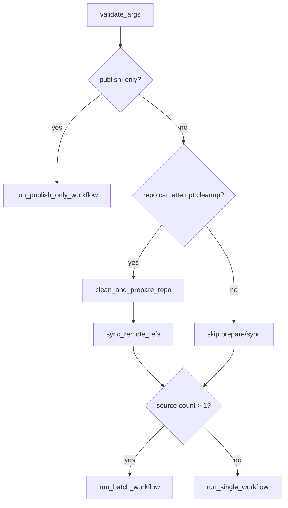
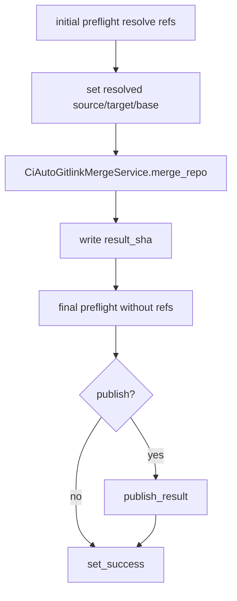

# CI 自动合并详细设计

## 1. 设计目标

CI 模式用于在无人值守环境中生成递归子模块合并结果。它的核心目标是：

- 自动完成根仓库和子模块 gitlink 冲突合并。
- 遇到普通文件冲突、`.gitmodules` 风险、子模块拓扑变化时安全失败。
- 对每个 Git 命令、preflight 检查、冲突材料、patch、最终结果输出结构化报告。
- 在失败时尽量恢复工作区，避免 CI runner 留下不可复用状态。
- 支持多分支 batch 合并，并在默认 `continue-success` 模式下跳过失败分支继续后续分支。
- 可选执行安全发布，使用 `force-with-lease` 和 `--recurse-submodules=check` 降低竞态风险。

CI 模式的策略是严格的：只有 gitlink 冲突会自动递归处理，普通文件冲突不会在 CI 中自动选择结果。

## 2. 入口与模块职责

CI 源码入口：

```powershell
python -m ci_merge_split --source origin/feature --target origin/main --repo_path C:\path\to\repo
```

`ci_merge_split/__main__.py` 调用 `ci_merge_split.commands.main()`。

| 模块 | 职责 |
|---|---|
| `runtime.py` | CLI 参数、`ExecutionContext`、`JsonReport`、`GitRunner`、输出路径解析。 |
| `commands.py` | 顶层 workflow、单分支、多分支 batch、失败处理、restore、进度输出。 |
| `preflight.py` | remote sync、子模块 fetch scope、preflight 检查和失败 reason 映射。 |
| `repository_ops.py` | Git 仓库状态检查、ref 解析、post-merge invariant。 |
| `repository_guards.py` | preflight / cleanup / post-merge guard facade。 |
| `recovery.py` | CI 合并前清理、snapshot restore。 |
| `snapshot_restore.py` | 快照记录和失败恢复。 |
| `artifacts.py` | 冲突 stage、patch、变更文件材料导出。 |
| `report_artifacts.py` | artifact facade。 |
| `publish.py` | CI publish 和 publish-only。 |
| `review.py` / `review_html.py` | 基于 JSON report 的 review 材料和 HTML。 |
| `merge_tool_adapters/ci_auto.py` | 将 CI runner 和 policy 接入公共递归 gitlink core。 |

## 3. CLI 参数模型

核心参数：

| 参数 | 含义 |
|---|---|
| `--source` | 来源 ref，可重复传入以启用 batch。 |
| `--multi-source` | 兼容逗号分隔来源，将每个 `--source` 按逗号拆分。 |
| `--target` | 目标 ref。 |
| `--repo_path` | 根仓库路径。 |
| `--remote` | 远端名，默认 `origin`。 |
| `--work_branch` | CI 本地工作分支，默认由 job id 生成。 |
| `--output_dir` | 报告、日志、patch、冲突材料输出目录。 |
| `--report` | JSON report 文件名或路径，默认 `merge-report.json`。 |
| `--log` | 命令日志文件名或路径，默认 `merge.log`。 |
| `--timeout` | 单条 Git 命令 timeout。 |
| `--max_depth` | 递归子模块最大深度，默认 16。 |
| `--submodule-fetch-scope` | 子模块 fetch 范围，`needed` 或 `all`，默认 `needed`。 |
| `--batch_failure_mode` | batch 失败策略，`continue-success` 或 `fail-fast`，默认 `continue-success`。 |
| `--publish` | 是否在合并后发布。 |
| `--publish_target` | 发布目标分支。 |
| `--publish_only` | 从已有 report 执行发布。 |
| `--from_report` | publish-only 使用的源 report。 |
| `--allow_partial_publish` | 允许发布 `partial_success` batch report。 |
| `--allow_clean_x` | 允许 CI cleanup 使用 `git clean -fdx`。 |
| `--console_log` | 输出简洁进度日志。 |
| `--auto_safe_directory` | 自动设置 Git safe.directory，默认开启。 |

参数归一化规则：

- `--source` 被规整为 `args.sources`。
- `args.source` 始终指向第一个 source，保持单分支兼容。
- 多个 source 启用 batch。
- batch 下禁止直接 `--publish true`，发布需通过报告中的 manual publish command 或 publish-only。
- `--publish true` 必须显式指定 `--publish_target`。
- `--publish_only true` 会强制 `args.publish = True`。

## 4. 执行上下文与报告初始化

`ExecutionContext` 持有：

- `args`
- `JsonReport`
- `root_repo`
- `job_id`
- `timeout`
- `max_depth`
- `allow_clean_x`
- `GitRunner`
- snapshot 列表
- 当前 batch step 上下文

`JsonReport` 初始化时会建立完整 report skeleton：

- `input`：输入参数快照。
- `output`：report、log、patch、conflicts、files 输出路径。
- `resolved`：source/target/merge-base/result SHA。
- `batch`：batch 总览、steps、successful_steps、failed_steps、manual_publish。
- `remote_sync`：fetch/sync 结果。
- `summary`：仓库数、子模块数、冲突数、fallback 数。
- `preflight` / `preflight_runs`：合并前后检查记录。
- `repositories`：每个参与合并的仓库详情。
- `conflicts`：冲突记录和 artifact。
- `snapshots`：失败恢复所需快照。
- `publish` / `publish_only`：发布状态。
- `commands`：所有 Git 命令结构化记录。
- `errors` / `warnings` / `restore`：错误和恢复记录。

如果输出路径位于目标仓库内部，report 会追加 `GENERATED_FILE_INSIDE_REPO` warning。

## 5. GitRunner 设计

CI 所有 Git 命令都通过 `runtime.GitRunner` 执行。

### 5.1 环境约束

每次运行 Git 时设置：

- `GIT_TERMINAL_PROMPT=0`：CI 中禁止交互凭据提示。
- `GIT_MERGE_AUTOEDIT=no`：禁止 merge commit 编辑器。
- `safe.directory=*`：在 `--auto_safe_directory true` 时注入 Git config，避免 runner 用户/工作区 ownership 差异导致失败。

### 5.2 命令记录

每个命令都会写入：

- JSON report 的 `commands[]`。
- 文本 log。
- 可选 console log。

记录包含 cwd、cmd、exit code、stdout、stderr、duration、timeout、attempt、network failure reason。

### 5.3 网络重试

以下 Git 命令被视为 network-sensitive：

- `clone`
- `fetch`
- `push`
- `pull`
- `ls-remote`
- `submodule update`
- `submodule sync`

失败时会根据 stderr/stdout/timeout 分类网络错误，如 DNS、connect、TLS、RPC、remote closed 等，并按 `--git-network-retries` 与 `--git-network-retry-delay` 重试。

## 6. 顶层 Workflow

`commands.run_workflow()` 流程：



准备阶段只在 repo path 是可识别 Git worktree 时运行：

1. `clean_and_prepare_repo()` 清理上一轮失败可能留下的 Git 状态。
2. `sync_remote_refs()` fetch root 和子模块必要 refs。
3. 再进入单分支或 batch 合并。

## 7. Remote Sync 与子模块 Fetch Scope

`preflight.sync_remote_refs()` 在 `SYNCING_REFS` 阶段执行：

1. `git fetch <remote> --prune`
2. `git submodule sync --recursive`
3. 根据 `--submodule-fetch-scope` fetch 子模块 refs。

### 7.1 `all` 模式

`all` 模式会：

- 读取 `git submodule status --recursive`。
- 对每个已初始化子模块执行 `git fetch --all --prune`。
- 未初始化子模块记录 skipped，不主动初始化所有子模块。

### 7.2 `needed` 模式

`needed` 是默认模式，目标是只 fetch 可能参与 gitlink 合并的子模块：

1. 解析所有 source、target 和 merge-base。
2. 对每组 source/target/merge-base 做 raw diff。
3. 收集 `.gitmodules` 未变化且 mode 仍为 `160000` 的 gitlink 路径。
4. 对这些路径初始化必要 worktree。
5. fetch 相关子模块。
6. 递归分析嵌套 gitlink 变化。

如果遇到无法安全判断的情况，会 fallback 到 `all`：

- raw diff 解析失败。
- `.gitmodules` 变化。
- 子模块新增、删除、重命名、类型变化。
- 子模块 gitlink 缺失。
- 分析超过最大深度。

## 8. CI Preflight

`preflight_check()` 是 CI 的硬门禁。它会记录到 `preflight_runs[]`，其中 `label="initial"` 的结果也会同步到 report 顶层 `preflight`。

检查项：

| check | 含义 | 失败 reason 映射 |
|---|---|---|
| `repo_path_exists` | 路径存在。 | `REPO_PATH_NOT_FOUND` |
| `repo_path_is_directory` | 路径是目录。 | `PREFLIGHT_FAILED` |
| `is_git_repository` | 是 Git worktree。 | `NOT_A_GIT_REPOSITORY` |
| `resolve_toplevel` | 能解析顶层路径。 | `PREFLIGHT_FAILED` |
| `no_operation_in_progress` | 没有 merge/rebase/cherry-pick/revert 等操作状态。 | `OPERATION_IN_PROGRESS` |
| `working_tree_clean` | 工作区干净。 | `WORKTREE_NOT_CLEAN` |
| `gitmodules_parseable` | `.gitmodules` 能被 Git config 解析。 | `GITMODULES_INVALID` |
| `submodules_initialized_and_at_head` | 递归子模块已初始化且位于记录的 gitlink HEAD。 | `SUBMODULE_NOT_READY` |
| `resolve_source` | source 能解析为 commit。 | `SOURCE_REF_NOT_FOUND` |
| `resolve_target` | target 能解析为 commit。 | `TARGET_REF_NOT_FOUND` |
| `source_target_have_merge_base` | source/target 有 merge-base。 | `NO_MERGE_BASE` |

单分支和 batch 每个 step 的 initial preflight 都会解析 source/target 和 merge-base。final preflight 不解析 refs，只检查合并后仓库状态。

## 9. 单分支合并流程

`run_single_workflow()`：



关键点：

- initial preflight 失败直接 `PREFLIGHT_FAILED`。
- source/target SHA 缺失会转为 `RESOLVED_SHA_MISSING`。
- merge 期间 `NonGitlinkConflictError` 会转为 `NON_GITLINK_CONFLICT`。
- final preflight 失败会转为 `FINAL_PREFLIGHT_FAILED`，并标记需要 restore。
- publish 仅在单分支且 `--publish true` 时允许。

## 10. CI 递归合并策略

`CiAutoGitlinkMergeService.merge_repo()` 的根仓库/子模块合并方式：

1. 记录 snapshot。
2. checkout 到 CI 工作分支，起点为 target SHA。
3. `submodule update --init --recursive --force`。
4. `git merge --no-ff --no-commit <source_sha>`。
5. clean merge：执行 post-merge guard。
6. 有冲突：
   - 如果没有 gitlink 或同时包含非 gitlink，交给 CI policy 失败。
   - 如果只有 gitlink，调用公共 engine 递归解决。
7. post-merge guard。
8. 构建 CI commit message。
9. commit pending merge。
10. 再次 update submodules。
11. 收集 repository details、patch、changed file artifacts。

CI policy 的后置 guard 包括：

- `ensure_no_unmerged_paths()`
- `ensure_gitmodules_not_changed()`
- `ensure_no_submodule_topology_change()`

这意味着 CI 自动合并只允许 submodule gitlink SHA 更新，不允许 `.gitmodules` 或子模块路径拓扑在自动合并中被改写。

## 11. 多分支 Batch 流程

多个 `--source` 会进入 `run_batch_workflow()`。batch 将每个 source 作为一个 step，按顺序合并到当前 target：

```text
step 1: source A -> original target
step 2: source B -> step 1 result
step 3: source C -> step 2 result
...
```

每个 step 记录：

- index / total
- source / target
- source_ref / source_sha
- target_ref / target_sha
- merge_base_sha
- status
- result_sha
- strategy
- pre_step_cleanup
- preflight
- command_range
- artifact_scope
- failure
- continued_after_failure
- restore_after_failure

batch 汇总字段：

- `original_target_ref`
- `original_target_sha`
- `final_result_sha`
- `failure_step`
- `successful_steps`
- `failed_steps`
- `errors`
- `status`
- `manual_publish`

每个 step 开始后、preflight 之前，会调用 `clean_and_prepare_repo()` 做一次 step 前清理。该清理复用 CI 逐级 fallback 链，并在 `batch.steps[].pre_step_cleanup` 中记录摘要；具体 fallback 条目写入顶层 `fallbacks[]`，`scope.type=batch_step_start`。第 2 个及后续 step 的 target 通常是上一 step 生成的本地结果 SHA，因此 fresh clone fallback 在替换工作区前会从旧工作区保留该 target ref，避免新 clone 丢失 batch 中间提交。

### 11.1 `continue-success` 默认策略

默认 `--batch_failure_mode continue-success`：

1. step 失败后标记 `status=failed`。
2. 错误写入 `batch.errors` 和 step `failure`。
3. 如果存在 `last_success_sha`，执行 `restore_batch_continue_state()`。
4. restore 成功后，`current_target` 回到最近成功 SHA。
5. 该 step 标记 `continued_after_failure=true`。
6. 后续 source 继续合并。

如果至少一个 step 成功，最终 report 状态为：

- `status=partial_success`
- `batch.status=partial_success`
- `exit_code=ExitCode.PARTIAL_SUCCESS`

如果没有任何成功 result，最终失败。

### 11.2 `fail-fast` 兼容策略

显式传入 `--batch_failure_mode fail-fast` 后：

- 任一步失败立即标记 batch failed。
- 不继续后续 step。
- 顶层进入失败处理和必要 restore。

这个策略保留给需要旧行为或强一致 gate 的 CI 流水线。

### 11.3 `NON_GITLINK_CONFLICT` 行为

普通文件冲突在公共核心中表现为 `NonGitlinkConflictError`，CI 会转换成：

- reason：`NON_GITLINK_CONFLICT`
- phase：根仓库为 `MERGING_ROOT`，子模块为 `MERGING_SUBMODULE`
- exit code：根冲突或子模块冲突对应的 CI exit code
- details：repo_path、conflicts、conflict_paths、conflict_count、stage 信息

其中 `conflicts` 只记录非 gitlink 冲突，不再混入已经可递归处理的 gitlink 冲突。`conflict_paths` 是所有非 gitlink 冲突路径的扁平列表，`conflict_count` 是对应数量。

CI 转换该错误时还会把这些非 gitlink 冲突同步到 report 顶层 `conflicts[]`，并刷新 `summary.conflicts`。这样 JSON report、review HTML 和外部 CI 消费者都能看到完整冲突文件列表，而不是只从错误 message 中读取第一条或少量信息。

在 batch 中：

- `continue-success`：该 source 失败并跳过，restore 后继续后续 source。
- `fail-fast`：立即失败并停止 batch。

## 12. Artifact 与报告材料

CI 会为 review 产出多类材料：

| 类型 | 目录 | 内容 |
|---|---|---|
| patch | `patches/` | 仓库级 diff patch。 |
| conflict | `conflicts/` | 冲突 stage 文件、worktree 文件、metadata。 |
| file | `files/` | 变更文件在 ours/result 等版本下的内容。 |

batch 中每个 step 使用 `batch/step-XX` 作为 artifact prefix，避免多个 step 的材料互相覆盖。

仓库 detail 导出后会额外扫描 `ours..result` 的 raw diff，发现 mode 保持 `160000` 的 gitlink SHA 更新时，会对子模块继续导出 `old_sha..new_sha` 的 repository detail。这样 clean merge 中没有产生 gitlink 冲突的子模块更新，也能在 `repositories[]` 中看到子模块内部文件级差异。

该补充导出是 best-effort：

- 已由 `gitlink.resolved` 事件导出的同一笔子模块 diff 会按 artifact prefix、repo path、ours SHA、result SHA 去重。
- 子模块路径不存在、不是 Git worktree、raw diff 解析失败或 artifact 导出失败时，写入当前 repository `warnings`，不改变 merge 结果。
- CI guard 已经拒绝 submodule add/delete/rename/type change，因此补充导出只处理 mode 仍为 `160000` 的 SHA 移动。

`NON_GITLINK_CONFLICT` 失败会把非 gitlink 冲突写入顶层 `conflicts[]`。这些记录至少包含 `repo_path`、`path`、`type`、`kind`、`stages` 和 `action=manual_required`。如果冲突来自异常转换路径且没有重新运行 artifact 导出，则这些记录可能没有 `artifacts` 字段；它们仍然是 report 和 HTML 展示完整冲突路径的权威来源。

repository detail 通常包含：

- repo path 和 display path。
- base / target / source / result SHA。
- strategy。
- commit log。
- changed files。
- patch artifact。
- content artifacts。

## 13. 结构化报告状态

顶层 `status` 可能为：

- `running`
- `success`
- `partial_success`
- `failed`

核心 exit code：

- `SUCCESS`
- `PARTIAL_SUCCESS`
- `PREFLIGHT_FAILED`
- `ROOT_CONFLICT`
- `SUBMODULE_CONFLICT`
- `GIT_COMMAND_FAILED`
- `PUBLISH_FAILED`
- `SYSTEM_EXCEPTION`

CI 主函数无论成功失败都会尝试 `ctx.report.finalize()` 和 `ctx.report.write()`。如果 report 写入失败，会在 stderr 输出 fallback summary。

## 14. 发布流程

### 14.1 单分支直接发布

`publish_result()` 只支持安全发布：

1. 要求 `--publish_target` 是远端分支名。
2. fetch 远端目标。
3. 如果目标不存在，必须显式 `--allow_create_publish_target true`。
4. 若目标存在，要求远端当前 SHA 等于合并前 target SHA，否则判定 `PUBLISH_RACE`。
5. 确认 result commit 在本地存在。
6. 确认 target SHA 是 result SHA 的祖先。
7. 先发布子模块 candidate refs。
8. 可选发布根仓库 candidate ref。
9. 使用 `--force-with-lease` 推送目标分支。
10. fetch 并验证远端目标 SHA 等于 result SHA。

子模块发布顺序按深度从深到浅，candidate ref 格式为：

```text
refs/heads/ci-merge-submodules/<job>/<path>
```

### 14.2 Publish-only

`--publish_only true --from_report <merge-report.json>` 用于从已有成功 report 发布：

- 源 report 必须是 `success`。
- 如果源 report 是 `partial_success`，必须传 `--allow_partial_publish true`。
- `partial_success` 还必须包含有效 batch failed step 元数据。
- publish-only 会从源 report 继承 result SHA、target SHA、repositories、summary 等信息。

batch 直接 `--publish true` 被禁止，因为 batch 可能产生 partial result，发布动作需要显式人工确认。

## 15. 失败与恢复

CI 错误统一为 `CiMergeError`，包含：

- `exit_code`
- `phase`
- `reason`
- `message`
- `details`
- `restore_needed`

顶层 `commands.main()` 捕获：

- `CiMergeError`
- 未预期异常，包装为 `SYSTEM_EXCEPTION`

如果 `restore_needed=true`，会调用 snapshot restore。

CI 主清理入口 `clean_and_prepare_repo()` 采用逐级 fallback：

1. `level_1_basic_cleanup`：基础 reset、clean、submodule update。
2. `level_2_abort_and_recursive_cleanup`：中止 merge/rebase/cherry-pick，并递归 reset/clean 子模块。
3. `level_3_sync_and_force_update`：sync 子模块、fetch/prune、force update。
4. `level_4_deep_submodule_cleanup`：按当前 `.gitmodules` 深度处理每个子模块。
5. `level_5_fresh_clone_workspace`：在前面层级都失败时，clone 新工作区并替换原工作区；如果 report/log/output 位于仓库内部，会拒绝该层以避免替换时丢失输出。

batch `continue-success` 的 step 级恢复使用 `restore_batch_continue_state()`，执行 `merge_cleanup_core.steps.ci_batch_continue_restore_steps()` 后再用 `verify_repo_ready()` 验证仓库是否可继续。

如果 restore 失败，错误转换为：

- reason：`BATCH_CONTINUE_RESTORE_FAILED`
- phase：`RESTORING`
- exit code：`CLEAN_OR_RESTORE_FAILED`

## 16. Review HTML 和二次消费

CI JSON report 是所有后续 review 材料的源数据：

- `ci_merge_review.py html` 可生成离线 Code Review HTML。
- `ci_merge_diff2html.py` 是兼容入口，直接调用同一套 HTML renderer。
- `ci_merge_review.py record` 可生成结构化 review 记录和 Markdown 摘要。
- 外部 CI 系统可直接读取 `status`、`exit_code`、`failure_reason`、`batch.successful_steps`、`batch.failed_steps` 判断流水线结果。

建议二次消费只依赖 JSON report，不解析 console log。console log 是给人看的进度信息，JSON report 才是稳定接口。

### 16.1 生成离线 HTML

常用命令：

```powershell
python ci_merge_review.py html --report C:\path\to\output\merge-report.json
```

未指定 `--output` 时，默认在 report 同目录生成 `merge-diff-review.html`。兼容入口等价于：

```powershell
python ci_merge_diff2html.py --report C:\path\to\output\merge-report.json --output C:\path\to\output\merge-diff-review.html
```

HTML 是 self-contained offline 页面，不依赖外部 CSS、JavaScript、CDN 或网络资源。页面主要包含：

- 总览指标：status、exit code、仓库数、变更文件数、冲突数。
- Automatic Review Flags：根据 report 自动标记失败、冲突、错误、递归子模块合并、publish/restore 异常等风险。
- Review Checklist：用于人工 review 的本地勾选项。
- Repository navigation：按仓库和文件导航变更。
- Diff view：读取 `repositories[].patches` 和 `changed_files[].patch_*`，展示 unified/split diff。
- File view：读取 `content_artifacts`，展示 ours/result 内容快照。
- Conflict view：读取顶层 `conflicts[]` 和冲突 artifacts，展示 base/ours/theirs/worktree。
- Commands view：展示 `commands[]`，便于回溯 Git 命令执行过程。
- Errors/restore/publish JSON 面板：保留结构化排障信息。

如果 patch artifact 缺失，HTML renderer 会尝试按 report 中的仓库路径和 SHA 现场读取 diff；因此长期归档或跨机器 review 时，应尽量保留 `merge-report.json` 同目录下的 `patches/`、`files/`、`conflicts/`。

### 16.2 导出 review 记录

review record 用于保存人工 review 结论，而不是替代 merge report。

```powershell
python ci_merge_review.py record --report C:\path\to\output\merge-report.json --decision APPROVED --reviewer qs --notes "reviewed"
```

默认输出：

- `merge-review.json`
- `merge-review.md`

`--decision` 支持：

- `APPROVED`
- `NEEDS_CHANGES`
- `REJECTED`
- `INFO_ONLY`

`--check` 可重复传入，用于记录 checklist：

```powershell
python ci_merge_review.py record --report C:\path\to\output\merge-report.json --check "Changed files reviewed=true" --check "Conflicts/errors reviewed=true"
```

review JSON 的核心字段：

- `schema_version`
- `reviewed_at`
- `reviewer`
- `decision`
- `report_path`
- `report`：只摘录 status、exit_code、failure_reason、resolved、summary、publish、restore 等关键结果。
- `risks`：根据 report 自动生成的风险项。
- `checklist`
- `file_notes`
- `notes`

### 16.3 Review 与 merge-report 的边界

`merge-report.json` 是事实来源，记录合并过程、命令、冲突、artifact 和最终结果。Review HTML 和 review record 都是派生材料：

- HTML 面向人工阅读和逐文件审查。
- review record 面向保存人工结论。
- 自动化判断仍应读取 `merge-report.json`。
- `NON_GITLINK_CONFLICT` 的完整冲突列表应读取顶层 `conflicts[]`；错误上下文中也会同步 `errors[].details.conflict_paths` 和 `conflict_count`。

## 17. CI 与手动逻辑差异

CI preflight 是硬门禁：

- 工作区必须完全干净。
- 子模块必须 initialized 并且位于记录 HEAD。
- 普通文件冲突不进入人工处理。
- `.gitmodules` 和 submodule topology 变化会被阻断。
- 失败以结构化 reason 退出。

手动流程允许更多人工介入：

- 可保留未受本次合并影响的 dirty submodule。
- 可通过外部冲突工具处理普通文件冲突。
- 可在本地人工 cleanup 和 publish。

因此二者共享公共 gitlink core，但不应把 preflight 策略完全合并。

## 18. 测试覆盖

CI 相关测试主要分布在：

- `test_ci_network_resilience.py`：网络失败分类与重试。
- `test_ci_submodule_fetch_scope.py`：needed/all fetch scope 与 fallback。
- `test_ci_review.py`：review/report 材料。
- `test_remaining_split_facades.py`：runtime、batch、preflight、publish facade 行为。
- `test_adapters.py`：CI adapter 接入公共 core。

重要回归场景：

- 单分支 clean merge。
- 纯 gitlink 冲突递归解决。
- `NON_GITLINK_CONFLICT` 转换。
- batch `continue-success` partial success。
- batch `fail-fast` 兼容。
- publish-only 拒绝失败 report。
- partial report publish 必须显式允许。
