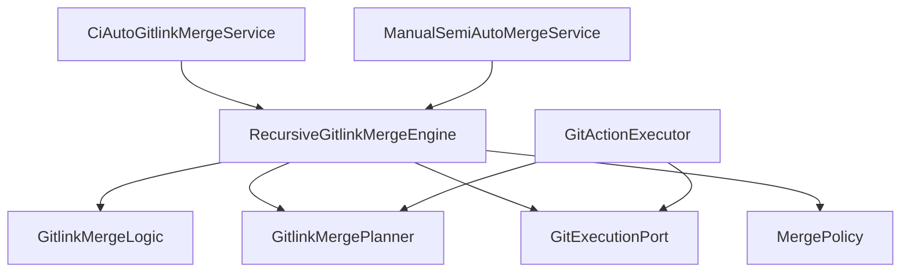

# 公共递归 Gitlink 合并核心详细设计

## 1. 设计目标

公共核心位于 `split_gitlink_merge/`，目标是把“递归解决 submodule gitlink 冲突”从 CI 和手动流程中拆出来：

- 核心只理解 Git 仓库、unmerged index、gitlink stage、递归合并决策。
- 核心不直接写 CI JSON 报告，也不直接弹 GUI 或启动人工冲突工具。
- CI 和手动流程通过 `MergePolicy`、`GitBackend`、adapter 注入各自策略。
- 纯逻辑部分可单测，Git 执行部分通过端口隔离，方便替换 runner。

这层的边界是：它负责把一个仓库中的 gitlink 冲突递归解决成可提交状态；至于什么时候 preflight、如何 fetch、如何记录报告、失败后是否继续、是否发布，由上层流程负责。

## 2. 模块分层

| 模块 | 职责 |
|---|---|
| `model.py` | 定义错误、Git 命令结果、冲突 stage、gitlink 决策、合并上下文、事件等数据合同。 |
| `planner.py` | 纯解析和决策逻辑，不执行 Git 命令。 |
| `logic.py` | 纯领域逻辑，负责冲突分组、构造 gitlink spec、判断是否需要 ancestry 查询。 |
| `ports.py` | Git 查询和变更端口协议。 |
| `executor.py` | 基于 Git backend 的默认执行器，封装 checkout、merge、stage、commit 等操作。 |
| `policy.py` | 策略钩子基类，定义 CI/手动在文件冲突、递归前准备、提交信息等处的差异点。 |
| `engine.py` | 编排 planner、logic、executor、policy，执行递归 gitlink 合并。 |

整体依赖方向：

## 3. 核心数据模型

### 3.1 Git 命令结果

`GitCommandResult` 是核心层统一接收 Git 命令结果的结构：

- `args`：实际执行的 Git 参数。
- `cwd`：命令执行目录。
- `returncode`：退出码。
- `stdout` / `stderr`：文本输出。
- `duration_ms`：执行耗时。

CI runner 会把自己的 `CommandResult` 转换成 `GitCommandResult`；手动默认使用 `SubprocessGitBackend`。

### 3.2 冲突模型

`ConflictStage` 表示 `git ls-files -u` 中的一条 index stage：

- `mode`：文件模式，submodule gitlink 为 `160000`。
- `sha`：stage 对应对象。
- `stage`：`1` base、`2` ours、`3` theirs。
- `path`：冲突路径。
- `raw`：原始行，便于报告和调试。

`Conflict` 聚合一个 path 下的所有 stage，并通过 `kind` 标记类型：

- `gitlink`：所有 stage mode 都是 `160000`，且至少有 stage 2 和 stage 3。
- `gitmodules`：路径是 `.gitmodules`。
- `file`：普通文件冲突。
- `unsupported_stage`：缺 stage 2 或 stage 3。
- `unparseable`：index 输出不可解析或缺少 stage 记录。

### 3.3 Gitlink 决策模型

`GitlinkDecisionKind` 表示单个 gitlink 冲突的处理策略：

| 决策 | 含义 |
|---|---|
| `same_sha` | ours 和 theirs 相同，直接使用该 SHA。 |
| `use_theirs` | ours 等于 base，说明目标侧未改，使用 theirs。 |
| `use_ours` | theirs 等于 base，说明来源侧未改，保留 ours。 |
| `fast_forward_to_theirs` | ours 是 theirs 祖先，快进到 theirs。 |
| `already_contains_theirs` | theirs 是 ours 祖先，保留 ours。 |
| `recursive_merge` | 两侧都改且不存在祖先包含关系，进入子模块递归合并。 |

### 3.4 合并结果模型

`GitlinkResolution` 记录单个 gitlink 的解决结果：

- parent 中的 submodule path。
- 子模块 repo path。
- base / ours / theirs / result SHA。
- 使用的策略。
- 是否发生了真正递归合并。

`RepositoryResolution` 记录一个仓库层级中解决的 gitlink 列表和遇到的普通文件冲突。

### 3.5 事件模型

`MergeEvent` 是核心层向上层暴露过程信息的轻量事件：

- `repo.check`
- `repo.clean`
- `repo.merge_clean`
- `repo.merge_conflicts`
- `gitlink.conflict`
- `gitlink.resolved`

CI policy 利用事件写报告和 summary；手动 policy 用事件汇总用户可读日志。

## 4. Planner 设计

`GitlinkMergePlanner` 是纯函数式组件，不执行 Git 命令。

### 4.1 解析 unmerged index

输入：

- `git diff --name-only --diff-filter=U`
- `git ls-files -u`

输出：

- 按 path 分组的 `ConflictStage`。
- 再分类成 `Conflict`。

分类规则的关键点是：**只有 mode 全部为 `160000` 且包含 stage 2/3 的冲突才被视为 gitlink 冲突**。这样可以避免把普通文件冲突、`.gitmodules` 变化和不完整 stage 误当成可自动处理的子模块冲突。

### 4.2 选择 gitlink 解决方式

`choose_gitlink_resolution()` 的决策顺序是：

1. ours == theirs：直接使用相同 SHA。
2. ours == base：使用 theirs。
3. theirs == base：使用 ours。
4. ours 是 theirs 祖先：快进到 theirs。
5. theirs 是 ours 祖先：保留 ours。
6. 否则：递归合并子模块。

这个顺序避免了不必要的子模块递归，也保证只有真正分叉的 gitlink 才进入更重的合并流程。

## 5. Logic 设计

`GitlinkMergeLogic` 同样不执行 Git 命令，主要负责把 planner 的低层输出转成 engine 可执行的上下文。

### 5.1 冲突分组

`group_conflicts()` 将冲突分成：

- `gitlinks`
- `non_gitlinks`

engine 会优先处理所有 gitlink。只有当前轮次没有 gitlink 时，才把普通文件冲突交给 policy。

### 5.2 构造 GitlinkConflictSpec

`build_gitlink_spec()` 从 stage 中提取：

- stage 1：base SHA，可为空。
- stage 2：ours SHA，必需。
- stage 3：theirs SHA，必需。

如果 ours 或 theirs 缺失，说明该冲突无法安全自动处理，抛出 `GitlinkMergeError`。

### 5.3 Ancestry 查询优化

只有在以下情况都不满足时，才需要查询 ancestry：

- ours == theirs。
- ours == base。
- theirs == base。

这样可以减少 Git 调用，并让纯决策路径更清晰。

## 6. 执行端口与默认执行器

`ports.py` 定义了核心需要的 Git 能力：

- 查询类：运行 Git 命令、读取冲突、检查 worktree、检查 commit 是否存在、判断祖先关系、读取 HEAD。
- 变更类：checkout、submodule update、merge no commit、stage path、commit pending merge。

`GitActionExecutor` 是默认执行器：

- 通过 backend 运行 Git。
- 调用 planner 读取并分类冲突。
- 对 Git 命令失败做统一异常封装。
- 默认 `SubprocessGitBackend` 可直接执行本地 Git 命令。

CI 不直接使用 `SubprocessGitBackend`，而是通过 `CiGitBackend` 适配 `ci_merge_split.runtime.GitRunner`，从而保留 CI 的命令记录、timeout、网络重试和 JSON 报告。

## 7. Engine 流程

### 7.1 合并两个提交

`RecursiveGitlinkMergeEngine.merge_commits()` 流程：

1. 检查递归深度。
2. 确认 repo 是 Git worktree。
3. 可选 checkout 到 ours。
4. 执行 `git merge --no-ff --no-commit <theirs>`。
5. 如果 merge clean，进入 policy 后置校验。
6. 如果出现冲突，调用 `resolve_active_conflicts()`。
7. 再次检查剩余冲突。
8. 通过 policy 构建提交信息。
9. commit pending merge 并返回 result SHA。

### 7.2 解决当前仓库冲突

`resolve_active_conflicts()` 是一个循环：

1. 读取当前 unresolved index。
2. 没有冲突时，执行 `policy.validate_after_conflicts()` 后返回。
3. 有 gitlink 冲突时，逐个调用 `resolve_gitlink_conflict()`，然后重新读取冲突。
4. 没有 gitlink 但有普通文件冲突时，调用 `policy.handle_file_conflicts()`。
5. 如果 policy 处理后仍有普通文件冲突，再次交给 policy；CI policy 会失败，手动 policy 可继续打开工具或要求人工处理。

### 7.3 解决单个 gitlink 冲突

`resolve_gitlink_conflict()` 流程：

1. 从 index stage 构造 base/ours/theirs。
2. 确认子模块 worktree 存在；如果缺失且 policy 允许，则执行 submodule update。
3. 确保 base/ours/theirs commit 在子模块中可用。
4. 必要时查询 ancestry。
5. planner 选择处理策略。
6. 若策略是递归合并：
   - 构造下一层 `GitlinkMergeContext`。
   - 调用 `policy.prepare_recursive_merge()`。
   - 在子模块内执行 `merge_commits()`。
7. 若策略是直接使用某个 SHA，则得到 result SHA。
8. checkout 子模块到 result SHA。
9. 在父仓库 stage submodule path。
10. 发出 `gitlink.resolved` 事件并返回 resolution。

## 8. Policy 扩展点

`MergePolicy` 是核心与上层策略隔离的关键。

| 钩子 | 默认行为 | CI 行为 | 手动行为 |
|---|---|---|---|
| `on_event()` | 无操作 | 写 summary、记录 gitlink conflict、收集仓库详情。 | 收集事件日志。 |
| `prepare_recursive_merge()` | checkout 子模块 ours，并可 update submodules。 | 清理子模块、创建 CI 深度分支、更新子模块。 | checkout/update，便于人工继续处理。 |
| `handle_file_conflicts()` | 抛 `NonGitlinkConflictError`。 | 抛 `NonGitlinkConflictError`，交给 CI 失败/跳过逻辑。 | 调用 mergetool 或外部冲突工具。 |
| `validate_after_conflicts()` | 无操作。 | 检查无 unmerged path、`.gitmodules` 未变、submodule topology 未变。 | 可按手动流程放宽。 |
| `build_submodule_commit_message()` | 默认递归提交信息。 | 使用 CI message service，写入 report 相关上下文。 | 使用手动流程提交信息。 |

## 9. Adapter 设计

### 9.1 CI Adapter

`merge_tool_adapters/ci_auto.py` 提供：

- `CiGitBackend`：把 CI `GitRunner` 适配为核心层 backend。
- `CiAutoMergePolicy`：接收核心事件，写 CI 报告，拒绝普通文件冲突。
- `CiAutoGitlinkMergeService`：在 CI workflow 中执行根仓库和子模块合并。

CI adapter 的重要策略：

- `fetch_missing_commits=True`，缺少必要子模块提交时允许 fetch。
- `update_submodules_before_recursive_merge=False`，递归前准备由 CI 自己的清理/同步逻辑控制。
- 普通文件、`.gitmodules` 和 unsupported stage 等非 gitlink 冲突统一转为 `NON_GITLINK_CONFLICT`。
- 混合冲突中如果同时存在 gitlink 和非 gitlink，CI adapter 只把非 gitlink 冲突写入错误 details 和 report 顶层 `conflicts[]`，避免把可递归处理的 gitlink 路径误报成人工文件冲突。
- 合并后必须通过 CI repository guards。

### 9.2 手动 Adapter

`merge_tool_adapters/manual_semiauto.py` 提供：

- `ManualMergePolicy`：对普通文件冲突调用 `git mergetool`。
- `ManualSemiAutoMergeService`：可对当前冲突或指定 ref 进行半自动递归处理。

当前主手动 CLI 仍保留自己的 `manual_merge_split.commands.process_repository()` 全流程，因为它承担更多人工保护逻辑，例如 dirty submodule 保留、报告文件、cleanup 和 batch skip。`manual_semiauto` 是公共核心向手动模式靠拢的 adapter 能力。

## 10. 错误边界

核心层错误主要分为：

- `GitlinkMergeError`：递归合并核心通用失败。
- `RequiredCommitFetchError`：尝试 fetch 必需 commit 失败。
- `RequiredCommitMissingError`：fetch 后 commit 仍不可用。
- `NonGitlinkConflictError`：严格 policy 看到普通文件或不支持冲突。

CI 上层会把这些错误转换为结构化 `CiMergeError`：

- 缺 commit：`SUBMODULE_COMMIT_FETCH_FAILED` 或 `SUBMODULE_COMMIT_NOT_FOUND`。
- 普通文件冲突：`NON_GITLINK_CONFLICT`。
- 其他异常：保留为系统异常或 Git 命令失败。

手动上层更偏向把错误展示给用户，并尽量保留现场供人工继续处理。

## 11. 递归深度与安全约束

engine 接收 `max_depth`，默认 16。每次进入子模块递归时 depth + 1，如果超过限制立即失败。

这个限制用于防止异常 submodule 图、循环引用或仓库结构错误导致无限递归。真实 Git submodule 不应形成循环 worktree，但显式深度约束仍是 CI 自动化中必要的保护。

## 12. 测试策略

公共核心测试重点：

- `test_planner.py`：冲突解析、类型分类、gitlink 决策。
- `test_logic.py`：冲突分组、spec 构造、ancestry 查询判断。
- `test_engine_integration.py`：真实或模拟 Git 仓库中的递归合并行为。
- `test_adapters.py`：CI/手动 adapter 与核心层的接口契约。

测试分层原则：

- planner/logic 尽量使用纯输入输出测试。
- engine 使用更接近真实 Git 行为的集成测试。
- CI/手动策略差异放在 adapter 和上层 workflow 测试中验证。
