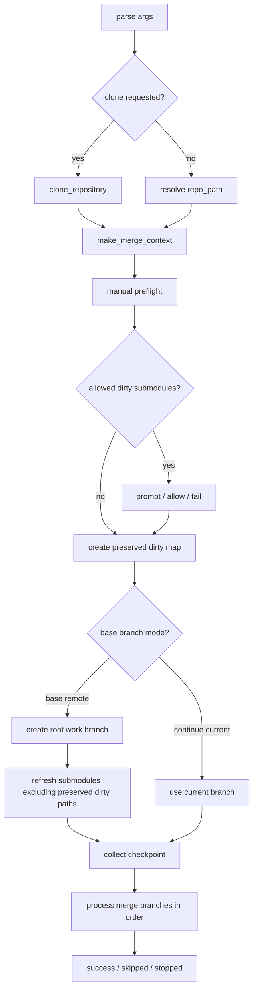

# 手动/GUI 合并详细设计

## 1. 设计目标

手动模式面向本地开发者和集成工程师，目标不是完全无人值守，而是：

- 在根仓库和多层子模块中辅助完成递归 gitlink 合并。
- 尽可能保护用户本地未提交改动，尤其是未被本次合并触碰的 dirty submodule。
- 对普通文件冲突启动外部冲突工具，由人确认结果。
- 在失败时生成可读 follow-up report，告诉用户进入哪个仓库、处理哪些文件。
- 支持 cleanup 让仓库回到可复用状态。
- 支持将当前根仓库 HEAD 和它引用的子模块提交递归发布到同名远端分支。
- 提供 GUI，降低命令行参数复杂度。

与 CI 不同，手动流程允许人工参与，也允许部分情况保留本地现场。因此它的 preflight 和失败处理策略比 CI 更宽，但交互更多。

## 2. 入口与模块职责

手动 CLI 入口：

```powershell
python -m manual_merge_split merge origin/feature --repo C:\path\to\repo --base-remote-branch origin/main
```

GUI 入口：

```powershell
python recursive_submodule_merge_gui.py
```

| 模块 | 职责 |
|---|---|
| `manual_merge_split/runtime.py` | CLI parser，包含 `merge`、`cleanup`、`publish`、`guided` 子命令。 |
| `manual_merge_split/commands.py` | 手动 merge/cleanup workflow，递归处理仓库和 batch 分支。 |
| `manual_merge_split/preflight.py` | 手动 preflight、dirty submodule 安全分析、保留路径映射。 |
| `manual_merge_split/repository_ops.py` | 手动 Git 操作、状态检查、分支创建、快照、rollback、cleanup。 |
| `manual_merge_split/file_conflicts.py` | 普通文件冲突工具调用、确认、marker 检查和 report 记录。 |
| `manual_merge_split/cross_submodule_moves.py` | 跨子模块移动文件的实验性处理。 |
| `manual_merge_split/publish.py` | 手动递归 publish。 |
| `manual_merge_split/guided_commands.py` | 交互式 CLI 向导。 |
| `recursive_submodule_merge_gui.py` | Tkinter GUI，构建 CLI argv 并展示进度。 |
| `merge_tool_adapters/manual_semiauto.py` | 基于公共 core 的半自动手动 adapter。 |

## 3. CLI 命令模型

### 3.1 Merge

```powershell
python -m manual_merge_split merge <merge_ref...> --repo <repo> --base-remote-branch <base>
```

核心参数：

| 参数 | 含义 |
|---|---|
| `merge_branches` | 一个或多个待合并 ref，按顺序合并。 |
| `--repo` | 根仓库路径，默认当前目录。 |
| `--clone-branch` / `--clone-url` / `--clone-path` | 可选先 clone 再合并，三者必须一起提供。 |
| `--base-remote-branch` | 根仓库起始分支，默认由模型常量配置。 |
| `--continue-current-branch` | 不创建/reset 工作分支，直接在当前根分支继续合并。 |
| `--work-branch` | 工作分支名，未提供时按日期模板生成。 |
| `--allow-dirty-submodules` | 允许 preflight 判定为不受影响的 dirty submodule 保持 dirty。 |
| `--no-prompt-dirty-submodules` | 发现可保留 dirty submodule 时不提示，直接失败。GUI 默认使用。 |
| `--report-file` | 冲突 follow-up report 文件名，默认 `merge_manual_todo.txt`。 |
| `--ignore-root-untracked-path` | 根仓库清洁检查时忽略指定 untracked path，可重复。 |
| `--file-conflict-mode` | 当前只支持 `tool`。 |
| `--conflict-tool-command` | 外部冲突工具命令模板，支持 `{file}`、`{repo}`、`{relative}`。 |
| `--conflict-tool-timeout-seconds` | 每个文件等待冲突工具的秒数，0 表示无限等待。 |
| `--no-confirm-after-conflict-tool` | 工具关闭后不再要求人工确认。 |
| `--enable-cross-submodule-moves` | 启用跨子模块移动文件实验性处理。 |
| `--verbose` | 输出详细命令和进度。 |

### 3.2 Cleanup

```powershell
python -m manual_merge_split cleanup --repo <repo>
```

cleanup 用于中止 merge、reset、清理 report，并可选重建工作分支：

- `--skip-submodule-update`
- `--rebuild-work-branch`
- `--base-remote-branch`
- `--work-branch`
- `--report-file`

cleanup 会打印明确警告，因为它可能递归执行 merge abort 和 `git reset --hard HEAD`。

### 3.3 Publish

```powershell
python -m manual_merge_split publish --repo <repo> --remote origin --push-target main
```

publish 参数：

- `--remote`
- `--push-target`
- `--check-only`
- `--no-sync-local-branches`
- `--no-branch-suffix`
- `--verbose`

手动 publish 不 force push。它只允许远端分支缺失、已最新、或可 fast-forward 的情况。

### 3.4 Guided

```powershell
python -m manual_merge_split guided --repo <repo>
```

guided CLI 是命令行向导，复用 `ManualCommandService` 的 merge/cleanup 能力。

## 4. GUI 设计

`recursive_submodule_merge_gui.py` 是 Tkinter 桌面入口，核心思想是：GUI 不重写业务逻辑，只负责收集输入、构造 CLI argv、运行手动 runtime 并展示输出。

GUI 包含两个主要 tab：

- Merge
- Publish

### 4.1 Merge Tab

Merge tab 输入项对应手动 merge 参数：

- merge branches 多行输入。
- root branch mode：base remote branch 或 continue current branch。
- work branch。
- conflict tool command。
- conflict tool timeout。
- allow dirty submodules。
- cleanup / rebuild work branch 相关选项。

GUI 对 dirty submodule 的默认策略更偏自动化：

- 如果未勾选 allow dirty，传入 `--no-prompt-dirty-submodules`，避免 GUI 进程阻塞在 stdin。
- 如果勾选 allow dirty，则传入 `--allow-dirty-submodules`。

### 4.2 Publish Tab

Publish tab 输入项：

- remote。
- push target。
- check only。
- sync local branches。
- allow branch suffix。

GUI publish 同样走 `manual_merge_split publish`，不直接操作 Git。

### 4.3 进度与友好提示

GUI 会对 CLI 输出做友好化映射：

- 子模块 merge required。
- conflict tool closed / timeout。
- recursive merge success。
- publish success。
- fatal/error/failed 等错误前缀。

这使 GUI 保持轻量，同时保留 CLI 的可测试性。

## 5. 手动 Merge 顶层流程

`commands.run_merge()` 流程：



返回码约定：

- `0`：成功，或 batch 中部分分支因缺少子模块提交被跳过但至少有成功分支。
- `1`：参数错误、preflight 失败、Git 操作异常等。
- `2`：合并停止，需要人工处理或没有成功分支。

## 6. 手动 Preflight

手动 preflight 位于 `manual_merge_split/preflight.py`，入口是 `preflight_repository()`。

### 6.1 基础检查

流程：

1. 要求 `base_ref` 非空。
2. 根仓库必须是 Git repo。
3. 根仓库不能有 merge in progress。
4. 根仓库必须配置 `user.name` / `user.email`。
5. 根仓库不能有直接改动，但可忽略指定 untracked path。
6. 执行 `refresh_repository_for_merge()`。
7. fetch base ref 和所有 merge refs。
8. 收集递归 submodule lineages。
9. 对每个子模块检查 Git repo、merge 状态、git identity。
10. 找出有直接改动的 dirty submodule。

### 6.2 与 CI Preflight 的关键差异

| 维度 | CI | 手动 |
|---|---|---|
| 根仓库清洁 | 必须完全 clean。 | 根仓库直接改动会阻断，可忽略指定 untracked path。 |
| 子模块 dirty | 任何 `submodule status` 异常都会阻断。 | dirty submodule 可做影响分析，未受影响时允许保留。 |
| ref 检查 | source/target resolve 和 merge-base 是硬门禁。 | fetch base/merge refs，用于 dirty submodule 安全分析。 |
| 交互 | 无交互。 | 可提示用户是否继续。 |
| 输出 | JSON preflight_runs。 | 人类可读错误或 warning。 |

### 6.3 Dirty Submodule 影响分析

手动模式最大的特殊能力是 `assess_dirty_submodule_impact()`。

它的目标是判断：某个 dirty submodule 的 gitlink 是否会被本次计划合并改变。

输入：

- 根仓库路径。
- dirty submodule 的 lineage，例如 `subA/subB`。
- base ref 和所有 merge refs 对应的 root commit variants。
- Git 操作接口。

判断逻辑：

1. 从根仓库开始，沿 lineage 逐层检查。
2. 对 base/merge refs 中每个 commit，读取对应 submodule path 的 gitlink SHA。
3. 如果某层 path 缺失或 gitlink 出现多个变体，说明计划合并可能改动该子模块或其祖先。
4. 如果改动发生在 dirty submodule 本身，阻断。
5. 如果改动发生在祖先子模块，继续进入下一层验证 nested commits 是否可用。
6. 如果整个 lineage 上 gitlink 保持一致，则认为 dirty submodule 不受本次合并影响，可保留。

输出分两类：

- `blocked_dirty_submodules`：会被本次合并触碰，必须清理后重试。
- `allowed_dirty_submodules`：看起来不受影响，可由用户确认保留。

### 6.4 保留 Dirty Submodule 的实现

如果用户允许保留 dirty submodule，会构造 `preserved_dirty_paths_by_repo`：

```text
parent repo -> child submodule paths that must not be updated
```

后续在根仓库 checkout/reset 后刷新子模块时，`refresh_submodules_after_root_checkout()` 会跳过这些 path，只 update 其他子模块，避免覆盖用户本地改动。

## 7. 仓库刷新策略

`refresh_repository_for_merge()`：

1. 确认 repo 是 Git repo。
2. `git submodule sync --recursive`。
3. 对缺失子模块执行 `git submodule update --init --recursive -- <path>`。
4. fetch 当前 repo 所有 remotes。
5. 递归进入已存在子模块重复上述步骤。

相比 CI 的 `needed` fetch，手动流程更直接、更重，但更适合人工运行：

- 不为性能做过多分析。
- 尽量把本地子模块准备好。
- 对缺失子模块直接初始化。

## 8. 分支准备策略

手动 merge 有两种根仓库起点模式。

### 8.1 Base Remote Branch 模式

默认模式：

1. 使用 `--base-remote-branch` 指定根仓库起点。
2. 创建或 reset 工作分支。
3. update 子模块，但跳过 preserved dirty paths。
4. 后续所有 merge 都在该工作分支上进行。

### 8.2 Continue Current Branch 模式

`--continue-current-branch`：

- 不创建新的根工作分支。
- 要求当前根仓库不是 detached HEAD。
- `base_ref` 使用 `HEAD`。
- 适用于用户已经手动准备好现场后继续处理。

## 9. 递归处理仓库

核心函数是 `commands.process_repository()`。

每一层仓库处理步骤：

1. 确认是 Git repo。
2. `ensure_repo_ready()` 检查无 merge in progress、必要时 clean、git identity。
3. 如果需要准备分支：
   - 根仓库创建 root work branch。
   - 子模块创建 submodule work branch，起点为父仓库 stage 2 gitlink。
4. 合并当前 merge target。
5. 根据 index stage 拆分：
   - submodule conflicts
   - file conflicts
   - incomplete stage conflicts
6. 可选处理跨子模块移动。
7. 递归处理每个子模块冲突。
8. 处理普通文件冲突。
9. 检查剩余冲突。
10. update submodules。
11. 如果有 pending merge 或工作区改动，commit。

### 9.1 子模块冲突处理

对子模块 path：

1. 从父仓库 unmerged index stage 2 读取 child start commit。
2. 从 stage 3 读取 child merge target commit。
3. 确认 child merge target 在子模块中可用。
4. 如果缺失，记录 `missing_submodule_commit`。
5. 如果可用，递归调用 `process_repository()`。
6. 子模块完成后，在父仓库 stage submodule path。

缺少子模块提交时，手动 batch 可能跳过该分支，而不是立即停止所有分支。

### 9.2 不完整 Stage

如果冲突缺少必要 stage，例如没有 stage 2 或 stage 3，会记录为 `incomplete_stage_conflict`，要求用户脱离工具手动处理。

这类冲突不能安全自动判断 ours/theirs，因此不会递归处理。

## 10. 普通文件冲突处理

普通文件冲突由 `manual_merge_split/file_conflicts.py` 处理。

### 10.1 外部冲突工具

`resolve_single_file_conflict()`：

1. 用 `{file}`、`{repo}`、`{relative}` 渲染命令模板。
2. 启动外部工具。
3. 等待工具退出，或在 timeout 后终止。
4. 如果启用确认，询问用户：
   - Enter / continue：继续。
   - r / reopen：重新打开工具。
   - s / stop：停止并记录失败。
5. 尝试 `git add` 文件。
6. 用 `git diff --check --cached` 检查 leftover conflict marker。
7. 检查该 path 是否仍处于 unmerged。
8. 成功则继续，失败则记录原因。

### 10.2 Report 记录

无法自动解决的文件冲突会写入 `merge_manual_todo.txt`：

- Repository
- Quick entry `cd /d <repo>`
- Reason
- Conflicted files
- 建议处理步骤

这个 report 是给用户继续人工处理的，不是 CI JSON schema。

### 10.3 Moved-away 文件

当启用跨子模块移动或检测到文件从旧位置移走时，`resolve_moved_away_file_conflicts()` 会尝试保留删除结果：

- `git rm -f -- <path>`
- 或 `git add -u -- <path>`

如果 Git 不再认为该 path unmerged，则视为已解决。

## 11. 跨子模块移动文件

`--enable-cross-submodule-moves` 是实验性功能，用于处理文件从一个子模块移动到另一个子模块的情况。

流程概念：

1. 收集子模块冲突对应的移动候选信息。
2. 识别 moved-away 和 moved-here 的子模块路径。
3. 旧位置尝试保留删除。
4. 新位置尝试应用移动后的文件内容。
5. 若内容冲突无法自动处理，记录为 `cross_submodule_move_conflict`。

该能力默认关闭，因为跨子模块移动涉及父仓库 gitlink、两个子模块工作树以及文件内容三方关系，风险高于普通 gitlink 冲突。

## 12. 手动 Batch 行为

手动 merge 接受多个 `merge_branches`，按顺序处理。

每个分支结束后会更新 checkpoint：

- 成功：记录 completed branch，并将当前仓库状态作为下一步 checkpoint。
- 缺少子模块提交且满足跳过条件：rollback 到 checkpoint，记录 skipped branch，继续下一个分支。
- 普通冲突或无法跳过的失败：写 report，停止 batch。

跳过条件由 `can_skip_failed_branch()` 判断：

- 当前分支未完成。
- 没有显式 rollback requested。
- 有 report entries。
- 所有 report entry category 都是 `missing_submodule_commit`。

这与 CI batch 的 `continue-success` 不同：

- CI 可跳过 `NON_GITLINK_CONFLICT` 等结构化可转换错误。
- 手动只自动跳过缺少子模块提交这类更明确的不可处理条件。
- 普通文件冲突通常停止，等待用户处理。

## 13. Rollback 与现场保护

手动流程使用 `ManualRepositoryOps.collect_repo_snapshot()` 记录 checkpoint。

失败时可能发生三种情况：

1. **跳过分支**：rollback 到最近 checkpoint，继续后续分支。
2. **自动 rollback 后停止**：当失败可自动恢复但不能继续时，保留 report。
3. **不 rollback，留现场**：为了保护本地改动或冲突现场，提示用户手动处理。

dirty submodule 保护会贯穿 rollback：

- rollback 时传入 preserved dirty paths。
- preserved dirty repos 不被误清理。
- report 可选择保留或删除。

## 14. Cleanup 流程

`run_cleanup()` 用于恢复仓库：

1. 打印危险操作警告。
2. 递归 cleanup root 和子模块。
3. abort in-progress merge。
4. reset hard。
5. 可选 submodule update。
6. 删除 manual report。
7. 可选重建工作分支。

返回信息包括：

- visited repositories。
- merges aborted/reset。
- hard resets。
- submodule updates。
- rebuilt work branches。
- removed report。

cleanup 是显式命令，不会被普通 merge 静默执行，避免误删用户现场。

## 15. 手动 Publish 设计

手动 publish 位于 `manual_merge_split/publish.py`，它的 source of truth 是根仓库当前 HEAD，而不是各个子模块 worktree HEAD。

### 15.1 Publish Plan

`collect_publish_plan()`：

1. 从根仓库 HEAD 开始。
2. 读取该 commit 中 `.gitmodules` 的 submodule paths。
3. 对每个 submodule path 读取 gitlink SHA。
4. 进入对应子模块 repo，以 gitlink SHA 作为 desired commit。
5. 递归生成 publish plan。

这样可以保证发布的是“父仓库提交实际引用的子模块提交”，不会因为子模块工作区临时 checkout 到别的 commit 而误推。

### 15.2 发布安全规则

发布前检查：

- push target 必须是合法分支名，不能是完整 ref，也不能以 `-` 开头。
- root remote 必须存在。
- 所有现有 repo 不能有 merge/rebase/cherry-pick/revert 等 in-progress 操作。
- `git submodule update --init --recursive` 成功。
- 每个 desired commit 必须本地存在。
- 每个子模块 repo 必须存在且是 Git repo。
- 每个 repo 都必须有指定 remote。

远端状态分类：

- `missing`：远端分支不存在，可创建。
- `up_to_date`：远端已指向 desired SHA，跳过 push。
- `fast_forward`：远端是 desired SHA 祖先，可 push。
- `non_fast_forward`：拒绝发布。

手动 publish 不使用 force push。

### 15.3 Local Branch Sync

默认会尽力创建或对齐本地分支：

- 本地分支不存在：创建到 desired SHA。
- 本地分支已经指向 desired SHA：复用。
- 本地分支指向其他 commit：默认创建 suffix branch，如 `<target>-publish-<shortsha>`。
- 传 `--no-branch-suffix` 后，遇到名称冲突会保留原分支不动。

`--check-only` 下只做 dry-run 和 “would create” 记录，不修改本地分支也不 push。

### 15.4 Push 顺序

publish plan 按 depth 从深到浅排序：

1. 最深子模块。
2. 上层子模块。
3. 根仓库。

每个 repo 先执行 `git push --dry-run --recurse-submodules=check`，再在非 check-only 模式下真正 push。

## 16. 手动与公共核心的关系

当前手动主流程主要使用 `manual_merge_split.commands.process_repository()`，不是完全由 `split_gitlink_merge.engine` 驱动。

原因是手动流程承担了额外职责：

- 工作分支创建和重建。
- dirty submodule 保留。
- 人工 conflict tool。
- manual report。
- batch skip 和 rollback。
- cleanup。
- publish。

`merge_tool_adapters/manual_semiauto.py` 提供了接入公共核心的半自动能力，适合未来逐步收敛递归 gitlink 处理逻辑，但不应牺牲上述人工保护策略。

## 17. CI 与手动的策略边界

| 主题 | CI | 手动 |
|---|---|---|
| 目标 | 自动合并候选，结构化报告。 | 辅助人工合并，保护现场。 |
| 普通文件冲突 | 失败或 batch skip。 | 打开工具，人工确认。 |
| dirty submodule | 阻断。 | 影响分析后可保留。 |
| `.gitmodules` 变化 | 阻断。 | 通常需要人工流程处理。 |
| batch 失败 | 默认 `continue-success`。 | 仅特定缺 commit 场景自动跳过。 |
| 发布 | 可 force-with-lease，适合 CI。 | 非 force，要求 fast-forward。 |
| 输出 | JSON report + artifacts。 | 人类可读 report + console/GUI。 |

因此手动逻辑不应简单复用 CI preflight；二者可以共享底层 Git helper 或公共 core，但策略层需要保持分离。

## 18. 测试覆盖

手动相关测试主要分布在：

- `test_manual_publish.py`：publish plan、远端状态、dry-run、local branch sync。
- `test_desktop_gui.py`：GUI argv 构造、输入校验、友好提示。
- `test_remaining_split_facades.py`：manual runtime、preflight、dirty submodule、cleanup facade。
- `test_adapters.py`：manual semi-auto adapter。

建议新增或维护的重点回归：

- dirty submodule 不受影响时允许继续。
- dirty submodule 会被 gitlink 改动时阻断。
- GUI 未勾选 allow dirty 时不阻塞 stdin。
- file conflict tool timeout 后保留现场。
- batch 缺少子模块提交时 skip 并 rollback。
- manual publish 拒绝 non-fast-forward。
- publish source of truth 来自父提交 gitlink，而不是子模块 worktree HEAD。
